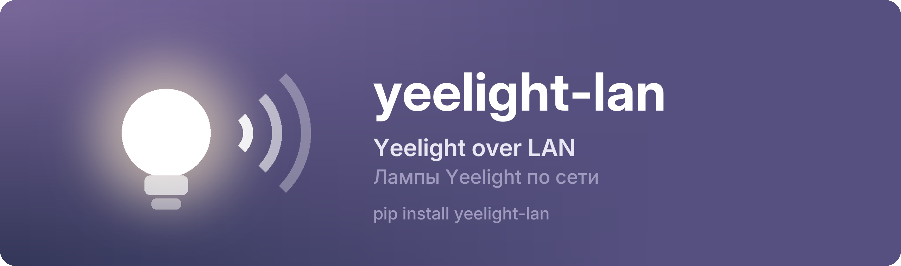

<p align="center"><a href="https://github.com/nowplaylab/yeelight-lan"></a></p>

<p align="center"><a href="https://github.com/nowplaylab/yeelight-lan/blob/main/README.md">English</a> &nbsp;·&nbsp; <b>Русский</b> &nbsp;·&nbsp; <a href="https://pypi.org/project/yeelight-lan/">PyPI</a></p>

<p align="center">
<a href="https://pypi.org/project/yeelight-lan/"></a>
<a href="https://github.com/nowplaylab/yeelight-lan/actions/workflows/tests.yml"></a>

<a href="https://github.com/nowplaylab/yeelight-lan/blob/main/LICENSE"></a>
</p>

Управление лампами и лентами Yeelight по домашней сети из Python: поиск, цвет, яркость и **музыкальный режим** для мигания в такт. Без облака и аккаунта. В комплекте **эмулятор ленты**: можно делать и проверять без железа.

Сделано [nowplaylab](https://github.com/nowplaylab) для [NowPlaying](https://github.com/nowplaylab/nowplaying-display): там лента берёт цвет обложки и пульсирует под басы.

## Установка

```
pip install yeelight-lan
```

Python 3.9+. Сначала включите для устройства **«Управление по локальной сети»** в приложении Yeelight.

## Как пользоваться

```python
import asyncio
import yeelight_lan

devices = yeelight_lan.discover()            # [Device(id, ip, name, model, ...)]
bulb = yeelight_lan.Bulb(devices[0].ip)

async def main():
    await bulb.set_rgb(0xff6600)             # плавно, 500 мс
    await bulb.set_bright(70)
    print(await bulb.get_props('power', 'bright', 'rgb'))

    # музыкальный режим: устройство само подключается и принимает команды без ответа и лимита
    async with bulb.music() as m:
        for level in (20, 100, 40, 100):
            m.send('set_bright', [level, 'sudden', 30])
            await asyncio.sleep(0.25)

asyncio.run(main())
```

Обычные команды устройство принимает **не чаще 60 в минуту на соединение**. `Bulb` открывает короткое соединение на каждую команду: так переживаются обрывы Wi-Fi и перезапуски устройства. Для всего, что быстрее, есть `MusicMode`.

В музыкальном режиме устройство само подключается **к компьютеру**, поэтому брандмауэр должен пропускать входящие подключения к вашей программе (в Windows: разрешите Python или свою программу в частной сети). Если не пропускает, `music()` падает с ошибкой, где это написано. Если у компьютера несколько сетей (VPN, второй адаптер), передайте его адрес в домашней сети: `bulb.music(local_ip='192.168.1.10')`.

## Эмулятор

```
python -m yeelight_lan.emulator
```

Притворяется лентой Yeelight с включённым управлением по сети: отвечает на поиск, принимает команды на порту 55443, соблюдает лимит 60 в минуту и умеет музыкальный режим. Откройте `http://<адрес компьютера>:47850` на любом устройстве дома: полоса светится тем, что ей прислали, внизу журнал команд.

Из своих проверок:

```python
strip = await yeelight_lan.emulator.start(port=0, web=None, ssdp=False)
bulb = yeelight_lan.Bulb('127.0.0.1', strip.port)
```

## Лицензия

MIT.
